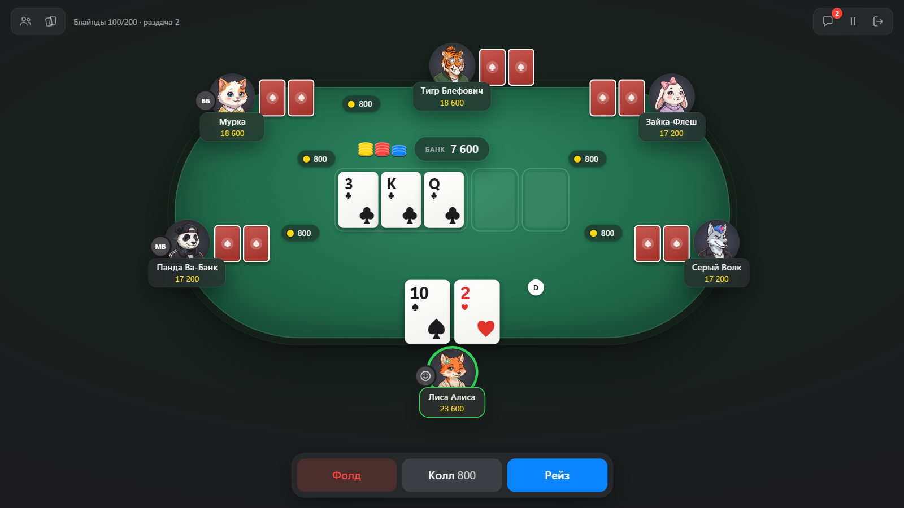
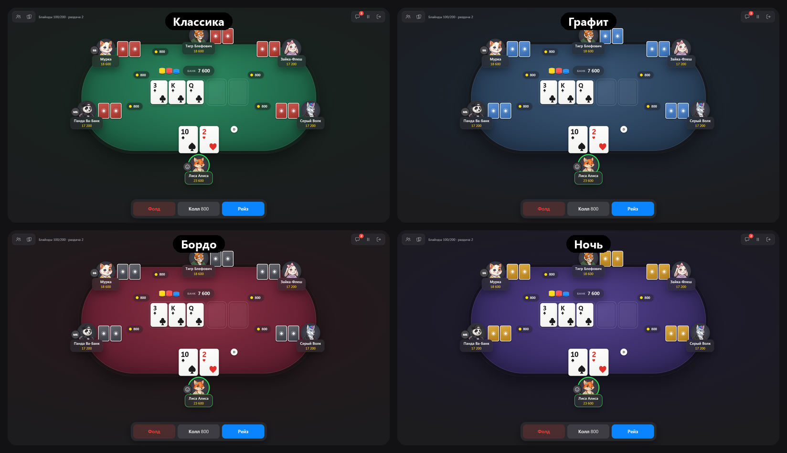
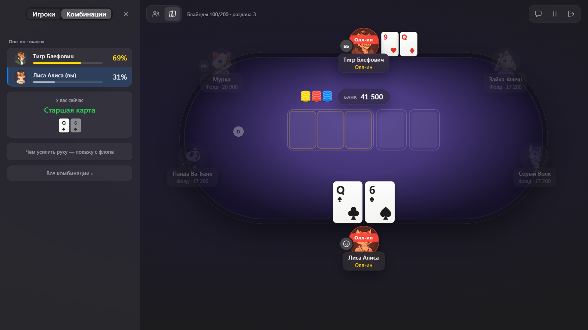
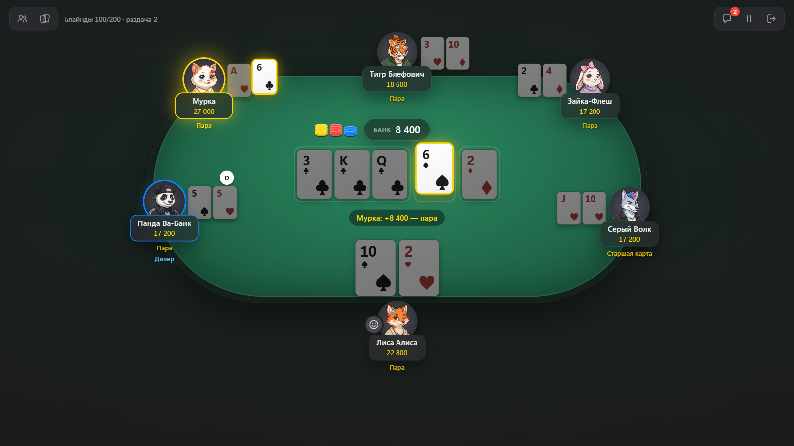
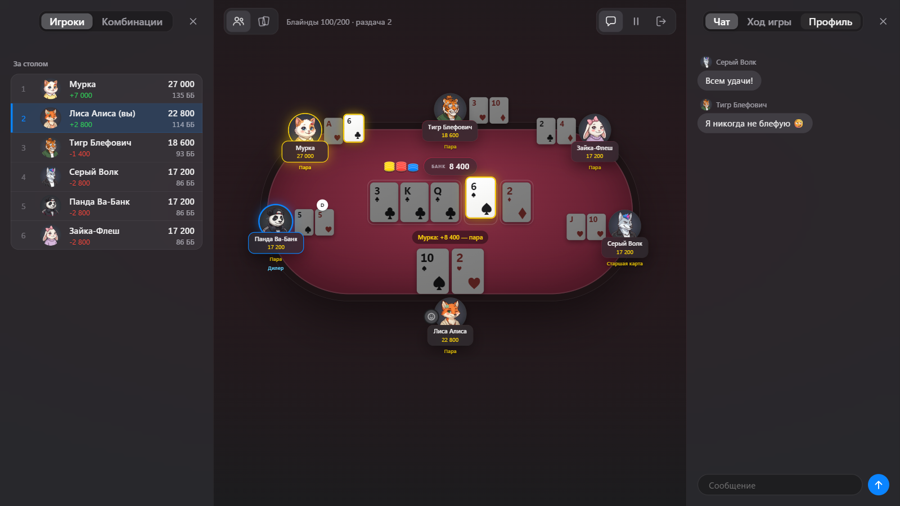

<div align="center">

# ♠ Покер Офис

**Техасский холдем для своих: по локальной сети, без интернета, регистрации и денег.**

Один компьютер запускает игру, остальные открывают ссылку в браузере и садятся за стол.

[](https://github.com/thepoluhin/poker-office/releases)
[](LICENSE)


[**Скачать**](https://github.com/thepoluhin/poker-office/releases/latest) · [Возможности](#возможности) · [Как начать](#как-начать) · [Из исходников](#запуск-из-исходников) · [English](#in-english)

<br>



</div>

## Зачем

Сыграть с коллегами в обеденный перерыв или после работы, не регистрируясь на покерных сайтах и не ставя ничего на телефоны. Игра идёт на фишки, на одном экране у каждого: свои карты, банк, ставки и чат.

## Возможности

- 🃏 **Честный холдем.** Блайнды, минимальный рейз, неполный олл-ин, побочные банки, деление банка с нечётной фишкой. 25 автотестов движка, включая 5000 случайных раздач.
- 🏆 **Турнир.** Приглашение всем за столом, блайнды растут по часам на сукне, места и золотая фишка победителю.
- 📈 **Шансы при олл-ине.** Проценты по улицам и подсказка, чем усилить руку.
- 💬 **Чат, реакции и ход игры.** 20 аватарок, 20 реакций (шесть любимых выбираются в профиле).
- 🎨 **Четыре цвета стола и два стиля карт.** Классика, графит, бордо и ночь.
- 💾 **Стол не теряется.** После перезапуска игроки возвращаются на свои места со своими фишками (стол хранится неделю).
- 🔒 **Безопасно для офисной сети.** Чужие карты не уходят в браузер, ход за другого не сделать, админ только на компьютере с игрой.

<div align="center">

</div>

<table>
<tr>
<td width="50%"><p align="center"><b>Олл-ин</b>: шансы считаются сразу</p></td>
<td width="50%"><p align="center"><b>Вскрытие</b>: сыгравшие карты подсвечены</p></td>
</tr>
<tr>
<td colspan="2"><p align="center"><b>Панели</b>: итоги игроков слева, чат и ход игры справа</p></td>
</tr>
</table>

## Как начать

1. Скачайте `Poker-Office-1.3.0.exe` из [Releases](https://github.com/thepoluhin/poker-office/releases/latest) и запустите на одном компьютере. Установка не нужна. Если SmartScreen предупредит о неизвестном издателе, нажмите «Подробнее» → «Выполнить в любом случае».
2. В окне игры появится адрес вида `http://192.168.0.102:3000`. Отправьте его коллегам: они открывают его в браузере на своих компьютерах в той же сети.
3. Каждый выбирает ник и аватарку и нажимает «Готов». Тот, кто запустил игру, становится админом и начинает партию.

Если Windows спросит про доступ к сети, разрешите доступ в частных сетях: иначе коллеги не подключатся.

## Важно знать

- Игра рассчитана на компьютеры и ноутбуки. Телефоны пока не поддерживаются: на узком экране стол не помещается.
- Админ — тот, кто запустил игру. Права админа нельзя получить с другого компьютера, даже под его ником.
- Если игрок не в сети, под его ником можно вернуться с любого компьютера, и место с фишками сохранятся. Поэтому ники лучше брать узнаваемые.
- Кто нажал «Выйти из игры» и вернулся под тем же ником, получает прежние фишки и счёт докупок. Свежий стек выдаётся только после «Начать заново».
- Стол хранится в `%LOCALAPPDATA%\PokerLAN\table.json`. После перезапуска сервера игроки садятся на свои места, но каждый снова нажимает «Готов».

## Запуск из исходников

Нужен Node.js 25.5 или новее. Сторонних пакетов нет.

```bash
cd src
node test.js     # тесты движка
node server.js   # игра на http://localhost:3000
```

| Переменная | Зачем |
|---|---|
| `PORT` | Порт вместо 3000 (окно приложения при занятом порте само пробует следующие) |
| `LOCALAPPDATA` | Папка, где лежит `PokerLAN\table.json`; для проверок удобно подменить на временную |
| `POKER_SINGLE_HOST=1` | Проверка на одном компьютере: админ только первая вкладка, остальные — обычные игроки |
| `POKER_MIN_MS` | Длина «минуты» турнира в миллисекундах (по умолчанию 60000), для быстрых проверок |

### Сборка exe

Нужны Node.js 25.5+ (флаг `--build-sea`) и .NET Framework 4 (есть в Windows).

```bash
powershell -ExecutionPolicy Bypass -File src/build/build.ps1
```

Скрипт прогоняет тесты, готовит аватарки, собирает сервер в один файл и окно приложения. Результат — `Покер Офис.exe` в корне (около 97 МБ). В репозиторий он не кладётся, готовая сборка выкладывается в Releases.

Лист реакций нарезается отдельно, когда меняется картинка (нужны Python, Pillow и numpy): `python src/build/reactions.py`.

### Как устроено

```
Покер Офис.exe (окно Windows, трей)
   └─ запускает server.js ── SSE: состояние стола ──▶ браузеры игроков
                          ◀── POST /api/cmd: ходы ──
```

| Папка или файл | Что внутри |
|---|---|
| `src/engine.js` | Правила холдема: раздача, ставки, банки, вскрытие |
| `src/server.js` | Сервер на Node.js без зависимостей: события (SSE), команды, турнир, сохранение стола |
| `src/public/` | Клиент: `index.html`, `app.js`, `style.css`, картинки |
| `src/launcher/Launcher.cs` | Окно приложения для Windows |
| `src/build/` | Сборка exe и подготовка картинок |
| `src/ДИЗАЙН-КОД.md` | Правила интерфейса: цвета, размеры, поведение элементов |
| `src/test.js` | Тесты движка |

## Планы

- Вёрстка для телефонов.
- Симметричная рассадка, когда за столом 2–4 игрока.
- Автотесты сервера.

Нашли ошибку или есть идея? [Откройте issue](https://github.com/thepoluhin/poker-office/issues). Если игра пригодилась, поставьте ⭐: так её найдут другие.

## In English

**Poker Office** is a Texas Hold'em game for 2–6 players over a local network. One Windows PC runs `Poker-Office-1.3.0.exe` (a single file, no install), everyone else joins from a browser via the LAN address shown in its window. No internet, no accounts, play chips only. Features: correct side pots and all-in rules, tournaments with blind clock, live all-in equities, chat and reactions, four table themes, table state survives restarts. The server is plain Node.js with zero dependencies (SSE + JSON commands). The interface is in Russian. MIT licensed.

## Лицензия

[MIT](LICENSE)
